# Rust Maya

[](https://github.com/rholmes69/Rust_Maya/actions/workflows/ci.yml)
[](https://github.com/rholmes69/Rust_Maya/releases/latest)

A Maya-style 3D content-creation app written in Rust with **egui** (UI) and **wgpu** (viewport rendering).
It covers the **UI, polygon and edge modeling, NURBS curves with surface tools, Quad Draw retopology, keyframe
animation, character rigging (with deformers and a one-click biped Quick Rig), look development (materials, lights,
cameras, shadows), UVs, a path tracer, glTF / USD import and export and an AI copilot**, plus
particles and cloth simulation. Fluids, hair and Arnold rendering show up in the menus as greyed-out "planned" items.

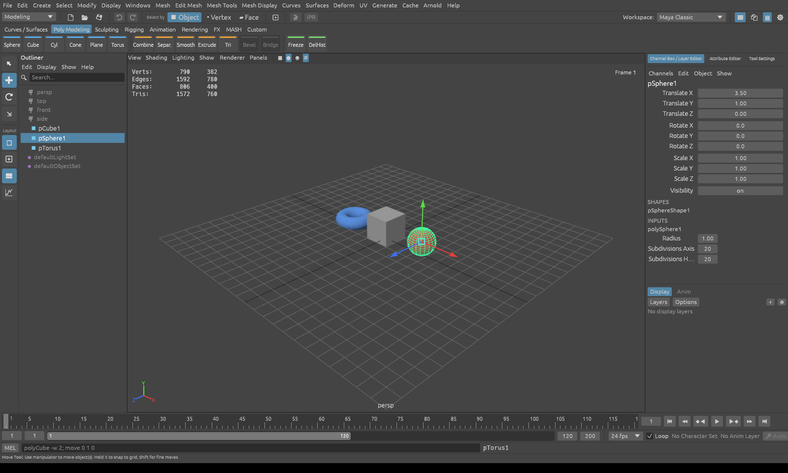

## Download

Ready-built Windows and Linux (x64) packages are on the [Releases page](https://github.com/rholmes69/Rust_Maya/releases). Unzip and run `rust_maya.exe` (Windows) or `./rust_maya` (Linux). The Linux build is made on Ubuntu 22.04 and runs on that or newer. Each release also lists the files' SHA-256 checksums in `SHA256SUMS.txt`.

## Automatic builds (v2.3)

GitHub Actions builds and tests every push to `main` and every pull request on **Windows** and **Linux** (`.github/workflows/ci.yml`):

1. `cargo build --release` and `cargo test --release`.
2. A smoke test of the batch renderer (`tools/ci_smoke.sh`). It makes an animated scene, renders a motion-blurred still with every pass and a 3-frame EXR sequence without a window, and checks the exit codes. The rendered images are uploaded so you can look at them.
3. The release binaries are kept as downloadable artifacts for 14 days (Actions → the run → *Artifacts*).

To publish a release, set `version` in Cargo.toml, commit, then tag and push:

```
git tag v2.3.0
git push Rust_Maya v2.3.0
```

`.github/workflows/release.yml` then builds, tests and smoke-tests both platforms. It packages `rust_maya-v2.3.0-windows-x64.zip` and `rust_maya-v2.3.0-linux-x64.tar.gz` (binary, README and VPS guide) and publishes them as a GitHub Release with checksums and auto-generated notes. It can also be re-run by hand for an existing tag (Actions → Release → *Run workflow*).

## Build & run (Windows / macOS / Linux)

1. Install Rust 1.96 or newer from https://rustup.rs (run `rustup update` if you already have it).
   On Linux, also install the build packages: `sudo apt install pkg-config libasound2-dev libxkbcommon-dev libwayland-dev libxcb-render0-dev libxcb-shape0-dev libxcb-xfixes0-dev` (Debian/Ubuntu).
2. In this folder, run:

```
cargo run --release
```

The first build downloads and compiles the dependencies, which takes a few minutes. The app opens with a demo scene
(pCube1, pSphere1, pTorus1). On Windows the release build runs without a console window.

Run the tests with `cargo test`. They cover the mesh and edge ops, scene graph, animation curves, camera math, MEL
commands, preferences, rigging (IK, skinning, constraints, driven keys, blend shapes, clusters, mirroring, Quick Rig),
materials/lights/cameras, the glTF and USD exporters, and the AI parsers and router.
`cargo test --release perf_ -- --ignored --nocapture` runs the viewport geometry benchmark.

## What's included

| Maya area | Implemented |
|---|---|
| **Menu sets** | Modeling / Rigging / Animation / FX / Rendering switch the menus after the common File · Edit · Create · Select · Modify · Display · Windows menus |
| **Status line** | Menu-set selector, new/open/save, undo/redo, Object/Vertex/Face selection modes, grid snap, Workspace selector, panel toggles |
| **Shelves** | Poly Modeling, Rigging, Animation and Custom tabs work (Script Editor → *Save to Shelf* adds buttons to Custom). The other tabs are placeholders. |
| **Workspaces** | Maya Classic, Modeling - Standard, Animation (opens the Graph Editor), Rigging |
| **Tool Box** | Select (Q), Move (W), Rotate (E), Scale (R), layout buttons |
| **Viewport** | wgpu with MSAA and depth; persp/top/front/side cameras; single or four-view layout (Space); wireframe (4), smooth shaded (5), textured (6), wire-on-shaded (Shading menu); grid; axis triad; poly-count HUD |
| **Navigation** | Alt+LMB tumble, Alt+MMB (or MMB) track, Alt+RMB or wheel dolly, F frame selection, A frame all |
| **Selection** | Click, marquee drag, Shift toggle, Ctrl deselect, Ctrl+Shift add; ray-cast picking |
| **Manipulators** | Move (world axes plus a screen-plane center handle), Rotate (gimbal rings showing the angle), Scale (per-axis and uniform). Hold X to snap (grid units / 15°) and Shift for fine control. |
| **Polygon modeling** | Cube, Sphere, Cylinder, Cone, Plane, Torus with live construction history (polyCube1 inputs you can edit). Vertex (F9), Edge (F10) and Face (F11) component editing, Extrude (Ctrl+E), Delete faces/verts/edges, Smooth (Catmull-Clark), Combine, Separate, Triangulate, Reverse normals, Freeze Transformations, Delete History |
| **Edge modeling** | Edge loop / ring selection (double-click an edge), Insert Edge Loop tool (Ctrl+R, live preview), Bevel (Ctrl+B), Bridge two faces, Merge (to center or by distance), Mirror geometry (with seam weld), Delete Edge — on the Poly Modeling shelf, Edit Mesh menu and as MEL |
| **Scene graph** | Hierarchy, Group (Ctrl+G), Parent (P), Unparent (Shift+P), Duplicate (Ctrl+D), Delete, Hide/Show. Maya-style unique names (pCube1, pCubeShape1). |
| **Outliner** | Tree with expand/collapse, search filter, double-click rename, drag-and-drop parenting, context menu |
| **Channel Box** | Translate/Rotate/Scale/Visibility (edits apply to every selected object), keyed channels highlighted red, channel right-click menu (Key Selected, Break Connections, Reset), SHAPES and INPUTS sections |
| **Layer Editor** | Display layers with Visibility (V) and Template (T) toggles, create from selection, add/remove/select members |
| **Attribute Editor** | Transform, display, shape stats, construction history, lambert colour, and animation curves with tangent type (Auto/Linear/Stepped) |
| **Animation** | Set Key (S), Shift+W/E/R key T/R/S, Auto Keyframe, auto-clamped spline curves, Time Slider with key ticks and scrubbing, Range Slider, fps, loop, playback (Alt+V), next/previous key (, .), step frame (Alt+, Alt+.) |
| **Graph Editor** | Curve list, key selection, tangent handles and types, insert/delete/copy/paste keys, pan and zoom (see Animation tools) |
| **Command line / Script Editor** | A MEL-like language: `polyCube -w 2 -n box; move -r 0 1 0; setKeyframe -at tx; select p*; parent; getAttr box.tx` … type `help` for the full list |
| **Files** | Save/Open scenes (`.rma`, JSON), Undo/Redo (100 levels), Recent Files, autosave every few minutes with crash recovery, "save changes?" prompt on New/Open/Quit, OBJ import/export (with .mtl), **glTF 2.0 import and export (.glb/.gltf)**, **USD export (.usda) and import (.usd/.usda/.usdc/.usdz)**, drag-and-drop import |
| **Preferences** | Windows › Preferences: autosave interval, demo scene; layout, shading and tool options are remembered between sessions |

## Rigging

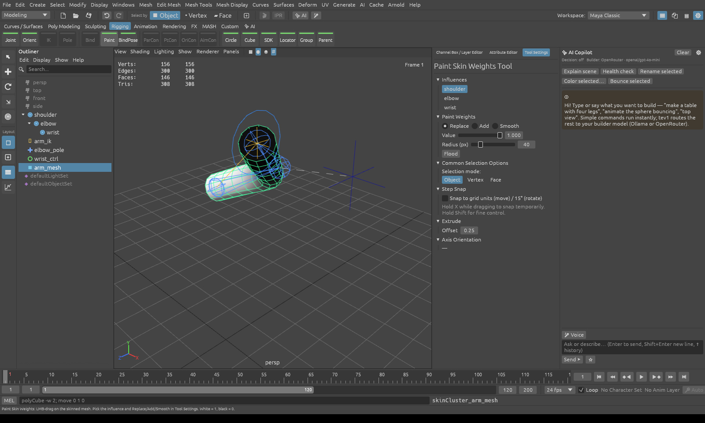

Switch the menu set to **Rigging** (or use the Rigging shelf):

| Menu | What it does |
|---|---|
| **Skeleton > Create Joints** | Click in any view to place joints; each new joint is the child of the previous one. **Enter** finishes the chain and orients it (X down the bone, Y up). Ortho views place joints on the view plane; hold X to snap to the grid. |
| **Skeleton > Orient Joint / Create IK Handle** | Re-orient selected chains. To make an IK handle, select the start joint then the end joint (chains of 3 joints use an analytic rotate-plane solver; longer chains use CCD). |
| **Skin > Bind Skin** | Select the joints (or just the root) and the mesh. Closest-distance weights, up to 4 influences per vertex. The mesh deforms live in the viewport and for picking. |
| **Skin > Paint Skin Weights** | Drag on the mesh with a brush (Replace / Add / Smooth); the mesh shows the current influence's weights in black and white. Flood, influence list and brush size are in Tool Settings. Each stroke is one undo step. |
| **Skin > Unbind / Go to Bind Pose** | Restore the pose captured at bind time. |
| **Constrain** | Parent, Point, Orient, Scale and Aim constraints (select the drivers, then the target; *maintain offset* option), Pole Vector, and Remove Constraints. |
| **Control** | Circle, square, cross, arrow, cube and sphere control curves, created at the selected object (circles face down the joint). **Set Driven Key…** opens Maya's two-column driver/driven window. |

Each frame evaluates rigging in this order: animation curves → driven keys → constraints → IK → skin deformation.
The Attribute Editor shows joint orient and radius, the IK chain and pole, skinCluster info, constraints (with delete)
and driven keys. Everything is also available as MEL (`joint`, `ikHandle`, `poleVectorConstraint`, `parentConstraint`…,
`skinCluster`, `gotoBindPose`, `circle`, `controlShape`, `setDrivenKeyframe`), so the AI copilot can build rigs too,
for example: *"rig the arm mesh with an IK arm, an elbow pole vector and a wrist control"*.

### Deformers and rig tools (v0.4)

| Menu | What it does |
|---|---|
| **Skeleton > Mirror Joints** | Mirrors the selected chain across YZ / XZ / XY and renames `L_` → `R_` (search/replace editable in the menu). |
| **Skeleton > Quick Rig (one-click biped)** | Select a character mesh standing on Y and facing +Z: builds a 25-joint skeleton fitted to its bounding box (hips, spine, chest, neck, head, clavicles, arms, legs, toes), mirrors the limbs, adds arm and leg IK with pole vectors, controls (`root_ctrl`, `cog_ctrl`, `chest_ctrl`, `head_ctrl`, hand/foot/clavicle controls) and binds the mesh. One undo step. |
| **Skin > Mirror Skin Weights** | Copies weights from +X to −X (or the inverse), swapping each influence for its mirror joint. |
| **Deform > Blend Shape** | Select target meshes, then the base. Weights appear as sliders in the Attribute Editor and in the Channel Box INPUTS, can be keyed (◆) and driven with Set Driven Key. |
| **Deform > Cluster** | Creates a cluster handle from the selected vertices (optional soft falloff); move/rotate/scale the handle to deform. |
| **IK handle (Attribute Editor)** | *Stretchy* (bones lengthen to reach the goal) and *Twist*. |

Deformer order is blend shape → skin → clusters. MEL: `mirrorJoint -myz -sr L_ R_ L_shoulder`, `copySkinWeights -mm YZ body`,
`quickRig body`, `blendShape smile face`, `setAttr face.smile 0.5`, `setKeyframe -at smile face`, `cluster -fo 1`,
`ikHandle -e -stretch on -twist 30 arm_ik`.

## Look development (v0.5)

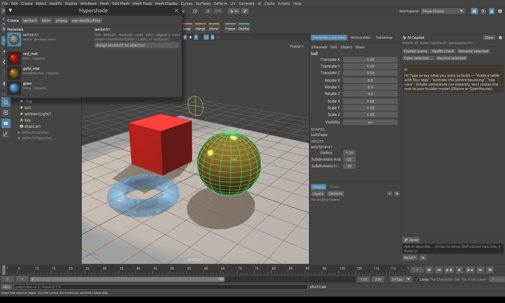

| Feature | Details |
|---|---|
| **Materials / Hypershade** | Windows › Rendering Editors › Hypershade (or the Rendering shelf): lambert, blinn, phong and standardSurface materials shown as swatches. Edit color, specular, roughness, metalness, incandescence and transparency; assign to the selection; select objects by material; duplicate; delete. Materials are shared, so editing one updates every object that uses it. Objects without a material keep their own lambert1 colour. The Attribute Editor shows the assigned material with a picker. |
| **Lights** | Create › Lights: ambient, directional, point and spot lights are scene nodes (they shine down their −Z axis). The Attribute Editor has colour, intensity, cone/penumbra and *Use Depth Map Shadows*. |
| **Viewport lighting** | Lighting › Use All Lights (**7**) lights the scene with its lights (up to 8) using Blinn-Phong plus a simple environment reflection for metals. **Shadows** uses a 2048² PCF shadow map from the first directional or spot light that casts shadows. **X-Ray** (**Alt+X**) makes surfaces see-through. All three are also buttons on the view toolbar. |
| **Cameras** | Create › Cameras › Camera / Camera from View. Panels › Look Through Selected (or Panels › Perspective › camName): tumbling the view moves the camera, and moving or animating the camera moves the view. Focal length and clip planes are in the Attribute Editor. |

MEL: `shadingNode -asShader blinn -n red -rgb 1 0 0`, `setAttr red.roughness 0.2`, `hyperShade -assign red box ball`,
`sets -e -forceElement redSG box`, `directionalLight -n sun -i 1.2 -rot -50 30 0 -sh on`, `spotLight -ca 40 -p 0 6 4 -aim 0 0 0`,
`camera -n shot -fl 50 -p 8 6 10 -aim 0 1 0`, `lookThru shot`, `lighting -all -shadows on`, `xray on`.

## UVs and textures (v0.7)

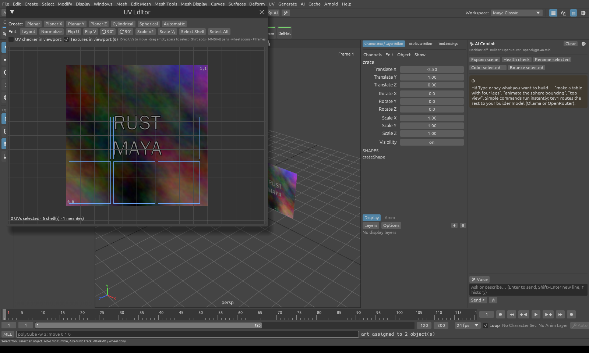

| Feature | Details |
|---|---|
| **UVs** | Every primitive is created with Maya-style UVs (the cube uses the cross layout). UVs are kept through extrude, smooth, triangulate, delete, combine, separate, mirror and OBJ round trips (edge tools like bevel or bridge drop them; re-project afterwards). |
| **Projections** | UV menu (Modeling menu set) or the UV Editor toolbar: **Automatic** (6 directions, packed), **Planar** (best plane / X / Y / Z), **Cylindrical**, **Spherical**. In face mode only the selected faces are projected. |
| **UV Editor** | Windows › Modeling Editors › UV Editor (or `uvEditor`): the 0–1 tile with the material's texture (or the checker) behind. Click, Shift-click or drag a marquee to select UVs; double-click (or *Select Shell*) for whole shells. Drag UVs to move them. Flip U/V, rotate ±90°, scale, Layout (packs shells without overlaps), Normalize. Wheel zooms, MMB or Alt pans, F frames. Fully undoable. |
| **Textures** | In a material (Hypershade or Attribute Editor), *Color Map › File…* connects a PNG, JPEG, BMP or TGA image, *Checker* connects the built-in UV checker, and *Repeat UV* tiles it. Textures show in the viewport (toggle with **6** or the ▣ button) through a mip-mapped texture array. The ▚ button / **UV Checker** shows the checker on every mesh. |
| **Export** | glTF writes `TEXCOORD_0`, embeds the images (PNG/JPEG as is, others re-encoded) and connects `baseColorTexture`. USD writes `primvars:st` (face-varying, indexed) and a `UsdPrimvarReader_float2 → UsdTransform2d → UsdUVTexture → UsdPreviewSurface` network (the checker is saved as `<scene>_uvchecker.png` next to the file). OBJ writes `vt` and a companion `.mtl` with `Kd` / `map_Kd`. |

MEL: `polyAutoProjection box`, `polyPlanarProjection -md y floor`, `polyCylindricalProjection`, `polySphericalProjection`,
`polyLayoutUV`, `polyNormalizeUV`, `polyEditUV -u 0.25 -v 0 -su 2 -sv 2 -a 90`, `polyFlipUV -ft 1`,
`setAttr wood.colorMap "C:/tex/wood.jpg"`, `setAttr wood.repeatUV 4 4`, `uvChecker on`, `textured off`.

### UV cut, sew and unfold (v1.5)

UV Editor toolbar (or MEL):

- **✂ Cut** (`polyMapCut`) splits UVs along the selected edges. Select them in edge mode in the viewport, or select the UVs along an edge in the UV Editor.
- **🧵 Sew** (`polyMapSewMove`) joins shells along the selected seam edges, moving, rotating and scaling the other shell onto the edge first.
- **Unfold** (`u3dUnfold`) flattens shells with Least Squares Conformal Maps (two pinned UVs, conjugate-gradient solve) and keeps the mesh's texel density. A planar-projected cylinder, cut along one seam and around its caps, unfolds with zero area stretch.
- A **Stretch** readout in the UV Editor shows the remaining distortion.

Scripts can pass edges by index, e.g. `polyMapCut -e 4 9 15 mesh`.

### Normal, roughness, metalness, occlusion and emission maps (v1.4–v1.5)

Materials have five more texture slots next to *Color Map*: **Occlusion Map** (greyscale; darkens ambient and bounced light) and **Emission Map** (colour; multiplies Incandescence), plus the three below.
Normal, Roughness and Metalness maps: **Normal Map** (tangent space, OpenGL / glTF convention), **Roughness Map** and **Metalness Map** (greyscale images that multiply the Roughness and Metalness values). They show in the viewport with Textured (**6**), where tangents come from screen-space derivatives so meshes need no stored tangents, and in the path tracer, which builds a per-triangle UV tangent frame. glTF import reads `normalTexture` and splits `metallicRoughnessTexture` into the two maps; glTF export writes them back, packing the two maps into G/B; USD export connects them to `UsdPreviewSurface` as raw-colour-space `UsdUVTexture`s.

`setAttr metal.normalMap "C:/tex/panel_n.png"`, `setAttr metal.roughnessMap "C:/tex/panel_r.png"`, `setAttr metal.metalnessMap "C:/tex/panel_m.png"`, `setAttr metal.occlusionMap …`, `setAttr metal.emissionMap …` (`none` disconnects).

glTF import also reads `occlusionTexture`, extracting the R channel since it is often packed with metallic-roughness, and `emissiveTexture`. glTF export writes both, plus per-vertex **TANGENT**s for normal-mapped meshes, and the Khronos validator reports no errors or warnings. USD export connects `occlusion` and `emissiveColor`.

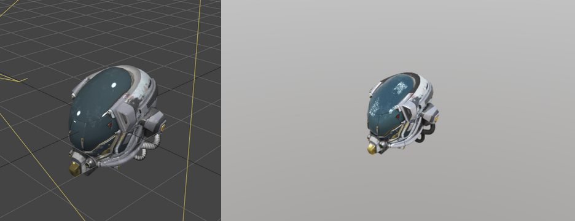

## Export (v0.6)

File › Export All / Export Selection (glTF / USD), or `file -export path.glb|.gltf|.usda [-es] [-na] [-bp]`:

| Format | What is written |
|---|---|
| **glTF 2.0** (`.glb` binary, `.gltf` with an embedded buffer) | Node hierarchy (joint orient folded into rotations), meshes with normals, PBR materials (metallic-roughness, emission, alpha blend, base colour / normal / packed metallic-roughness textures), skins (joints + inverse bind matrices, 4 influences), blend shapes as morph targets (with target names), baked animation of every node that moves over the playback range (including motion driven by constraints, IK and driven keys) and of morph weights, `KHR_lights_punctual` lights and perspective cameras. Validated with the Khronos glTF Validator (0 errors). |
| **USD** (`.usda`) | Xform hierarchy, Mesh, BasisCurves (degree-1 curves and rig controls), NurbsCurves (cubic curves, v1.7), UsdPreviewSurface materials with bindings, UsdLux lights (DistantLight, SphereLight, spot via ShapingAPI, DomeLight for ambient), Camera, transform animation as time samples. **Skinned meshes export as UsdSkel** (v1.3): a `SkelRoot` with a `Skeleton` (joint paths, bind and rest transforms), a `SkelAnimation` with per-frame joint translations, rotations and scales (including motion from IK, constraints and controls) and blend-shape weights, plus the mesh with `jointIndices`/`jointWeights`, `geomBindTransform` and `BlendShape` targets. Other deformers (clusters, lattices, wraps, blend-shape-only meshes) are **baked as per-frame points**; turn on File › *USD: bake skinning to points*, or use `-bp`, to bake skinned meshes too. Opens in `usdview` and any USD-aware DCC. |

The UsdSkel output was checked with Pixar's USD (`pip install usd-core`): `tools/check_usdskel.py skel.usda baked.usda` skins every mesh with UsdSkel at every frame and compares it with the point-baked export. A Quick-Rigged walk with an animated blend shape matches to within 0.00001 units over 120 frames, and the stage passes all of USD's validators. `cargo test usdskel_matches -- --ignored` runs the same check.

Not exported: cluster deformers in glTF (glTF has no equivalent), ambient lights in glTF, NURBS-style control curves in glTF.

## Import (v0.8)

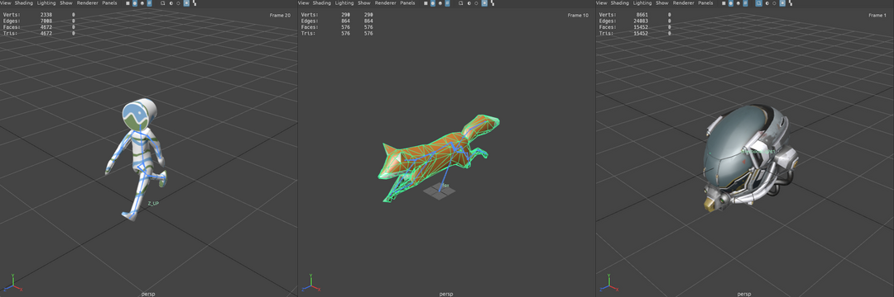

File › Import (FBX / glTF / USD / OBJ)…, drag and drop a file onto the window, or `file -import path [-take animName]`:

| Format | What comes in |
|---|---|
| **glTF 2.0** (`.glb`, `.gltf` with embedded, external or data-URI buffers) | Node hierarchy (TRS or matrix), meshes (triangles, strips, fans; vertices welded so edges are connected), UVs, PBR materials with the base-colour texture (embedded images are saved to `<file>_textures/`), skins → joints + skinCluster (exact glTF bind matrices), morph targets → blend shapes (with names and default weights), the first animation (or `-take Walk`) → keyframes on translate/rotate/scale and blend weights (LINEAR, STEP and CUBICSPLINE samplers, sparse accessors), `KHR_lights_punctual` lights and perspective cameras. One undo step. |
| **USD** (`.usd`, `.usda`, `.usdc`, `.usdz`) | See [USD import](#usd-import-v16) below. |
| **OBJ** | Meshes with UVs, plus materials from the `.mtl` (`Kd` colour and `map_Kd` texture). |

Normal and metallic-roughness maps have been imported since v1.4, with the packed glTF texture split into roughness and metalness maps; occlusion and emissive maps since v1.5. Orthographic cameras are not imported yet.
Tested against the Khronos sample models CesiumMan, Fox (3 takes), RiggedFigure, AnimatedMorphCube, BoxAnimated, BoxTextured and DamagedHelmet, and with Rust Maya's own glTF round-trip (rig, skin, blend shape, animation, texture, light, camera).

### FBX import and export (v2.1)

`file -import character.fbx [-take Run]`, `file -export scene.fbx [-es] [-na] [-bo]`, File › Import / Export, or drag and drop.

| | |
|---|---|
| **Import** (FBX 2011 and newer, binary including 7.5's 64-bit offsets and zlib arrays, and ASCII) | The model hierarchy. Pre-rotations become joint orients. Pivots, offsets, post-rotations and rotation orders are baked into the transforms. Geometric transforms are applied to the mesh points. Units are converted to metres and Z-up files to Y-up. Meshes keep their file vertex order, UVs and hard edges (from edge or polygon smoothing groups, or from the authored normals); faces with several materials are split into one sub-mesh per material. Materials come in with diffuse, emissive, transparency and shininess, plus colour, normal and emissive textures (external, or embedded and extracted to `<file>.fbm/`). Also: skin clusters with exact bind matrices, blend shapes, cameras and lights, and animation stacks (`-take`). Curves map onto keyframes (step / linear / spline); transforms with pivots or other rotation orders are baked per frame. |
| **Export** (binary FBX 7.4, metres, Y up) | Hierarchy (joints as LimbNodes, joint orient as PreRotation, or folded into the rotation with `-bo`), meshes with per-corner normals, edge smoothing (hard edges), UVs and a material, Phong materials with texture file links, skin clusters + bind pose, blend shapes, cameras, lights, and animation sampled every frame (transforms and blend-shape weights). |

Checked against the 48 FBX test files that ship with the Open Asset Import Library (assimp). 47 load; the 48th is malformed and assimp rejects it too. For 38 of them the triangle counts match assimp exactly. The other 9 differ only where assimp merges instanced or same-named meshes, turns collinear polygons into lines, or cuts concave polygons differently. Bounds match assimp after unit conversion. Exported files load in assimp, and a rigged, animated Quick Rig character read back through assimp matches the original to within a millimetre. Rust Maya's own FBX round trip reproduces skinned and blend-shaped positions on every frame. FBX 6 (pre-2011) files and NURBS curves in FBX aren't supported.

### Mesh › Reduce and Soften / Harden Edge (v2.1)

- **Reduce** (`polyReduce -p 75 mesh` removes 75 % of the triangles): quadric-error edge collapses that keep borders, UV seams, skin weights and blend shapes, and never flip faces.
- **Soften Edge / Harden Edge / Set Normal Angle** (Mesh Display menu, or `polySoftEdge -a 180|0|angle mesh` or `mesh.e[...]`): sets the soft and hard edges that drive the vertex normals in the viewport, renders and exports (glTF, USD, FBX). Hard edges are saved with the scene.

### USD import (v1.6)

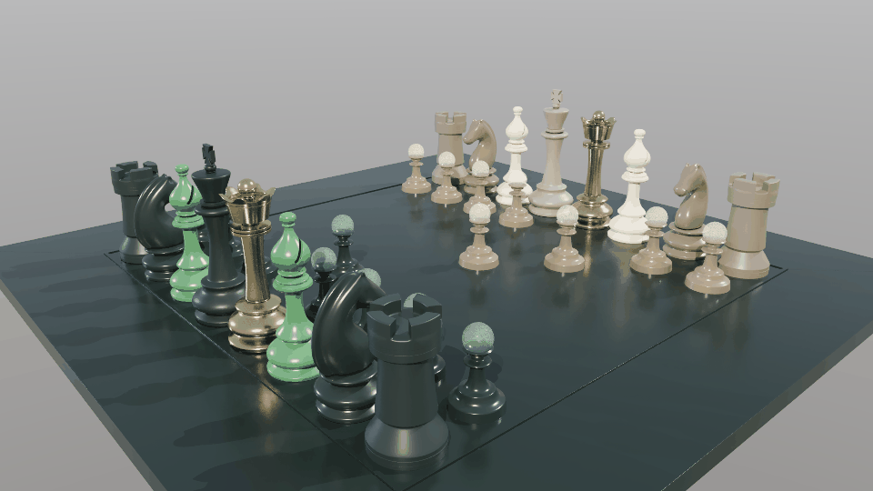

*The [OpenChessSet](https://github.com/usd-wg/assets/tree/main/full_assets/OpenChessSet) by Side Effects, artwork by Moeen Sayed and Mujtaba Sayed: binary-geometry assets with payloads, shading variants, MaterialX looks and PointInstanced pawns, imported and path-traced in Rust Maya.*

`file -import stage.usd` (or `.usda`, `.usdc`, `.usdz`) builds the stage as Maya-style nodes in one undo step:

| | What comes in |
|---|---|
| **Layers** | Text `.usda`, binary `.usdc` (read with the pure-Rust [openusd](https://crates.io/crates/openusd) crate), and `.usdz` packages, which are unpacked to a temp folder so their textures resolve. |
| **Composition** | `subLayers`, `references` and `payload` (to other files or to prims in the same layer, with `defaultPrim`), `inherits` and `specializes`, and **variant sets** with their selections, including nested sets and selections made by the referencing prim. Opinions merge strongest first, in USD's LIVRPS order. `active = false` prims are skipped. |
| **Geometry** | Xform hierarchy with every xformOp (translate, rotate*, orient, scale, transform, `!invert!`, animated → keys), Mesh (face-varying / vertex / uniform UVs with indices, left-handed orientation, displayColor), the intrinsic primitives Cube / Sphere / Cylinder / Cone / Capsule / Plane (with `axis`), BasisCurves and NurbsCurves, and **PointInstancer** (one group per instance with its position, orientation and scale). |
| **Looks** | UsdPreviewSurface networks (UsdUVTexture colour, normal, roughness, metallic, occlusion, emissive maps, UsdTransform2d repeat, through NodeGraph outputs), **MaterialX** (`.mtlx` files referenced from USD and inline `ND_standard_surface` / OpenPBR shaders: base colour, metalness, roughness, normal map, emission, opacity, transmission), and materials whose colour comes from the mesh's `displayColor` primvar (each mesh gets a tinted copy). Identical materials repeated across instanced assets are shared. EXR / HDR textures load too. |
| **Characters** | **UsdSkel**: Skeleton → joints, SkelAnimation → keys, joint influences → skinCluster, BlendShape → blend-shape targets with weight curves. |
| **Lights, cameras, stage** | UsdLux distant / sphere / spot (ShapingAPI) / rect (area) / dome lights, cameras (focal length, clipping, depth of field), frame rate and playback range. Z-up stages and `metersPerUnit` are converted to Y-up metres. |

Notes in the status line report anything skipped (for example a missing referenced file). Not supported: value clips, relocates, point-animated (time-sampled) meshes beyond the first sample, and MaterialX node graphs beyond image / normal-map chains.

The importer is checked against Pixar's USD in two ways:

- Every Rust Maya export round-trips: export → import → re-evaluate matches the source scene at every frame, including UsdSkel characters, and `usdcat`-reserialised copies of those exports import the same way.
- `USD_CORPUS=<dir> cargo test --release usd_corpus -- --ignored --nocapture` imports every USD file under a folder. When a `<name>.flat.usda` copy flattened by pxr sits next to a file (`tools/usd_flatten.py <dir>` makes them), it also checks that our composed stage matches pxr's mesh count and world-space bounds. On the [usd-wg assets](https://github.com/usd-wg/assets), all 193 test and full assets import, and 192 match pxr exactly. The exception is a deliberately degenerate `timeCodesPerSecond = 0` test.

The viewport splits very large scenes across several GPU vertex buffers, so million-triangle stages like the chess set display normally.

## Animation tools (v0.9)

| Tool | Details |
|---|---|
| **Graph Editor** | Click, Shift-click or box-select keys; drag to move them (whole frames, Ctrl locks the value); **tangent handles** on selected keys (drag to edit, Shift breaks in/out); per-key tangent types **auto, spline, linear, flat, step** (toolbar, Key › Tangents or `keyTangent`); Ctrl+click a curve to insert a key; Del deletes; copy/paste keys. |
| **Dope Sheet** | Windows › Animation Editors › Dope Sheet (or `dopeSheet`): summary and channel rows of diamonds; select, box-select, drag to retime, Del, click the ruler to scrub, wheel zoom. |
| **Ghosting** | Visualize › Ghost Selected (`ghost on`): onion-skin wireframes before (blue) and after (orange) the current frame; count and step are adjustable. Ghosting a rig control or joint ghosts the skinned character. |
| **Editable motion trails** | Visualize › Create Editable Motion Trail (`motionTrail on`): the path over the playback range with frame ticks and red key markers. **Drag a red marker in the viewport** to move that key (translate keys are set at that frame). |
| **Pose Library** | Save poses of the selected controls (or a whole rig with *hierarchy*), apply them with a blend amount, key on apply, or **mirror** them to the other side (L_/R_, Left/Right names). Poses are saved in the scene. |
| **Retargeting** | Animation › Skeleton › Retarget Animation… (or `retarget -src A -dst B`): joints are matched by name and body part (Mixamo, Quick Rig, `leg_joint_L_1`-style chains, `thigh_l`…), the motion is transferred as world-space rotation offsets from each skeleton's bind pose with a facing correction, the hip translation is scaled by leg length, and keys are baked on every frame. Example: import CesiumMan.glb, Quick Rig a character, retarget the walk onto it. |

## Modeling tools (v1.0)

| Tool | Details |
|---|---|
| **Multi-Cut** | Mesh Tools › Multi-Cut (shelf *MCut*, `setToolTo multiCut`): click points on edges (near a vertex snaps to it), Enter or right-click cuts, Esc cancels. UVs are interpolated. Scripted: `polySplit -ep 4 0.5 -ep 9 0.5 mesh`. |
| **Soft Select** | **B** toggles it (Tool Settings › Soft Selection sets the falloff radius). Moving, rotating or scaling vertices, edges or faces pulls the neighbours with a smooth falloff; affected vertices are tinted yellow → red. `softSelect -sse on -ssd 1.5`. |
| **Sculpt brushes** | Sculpting shelf: **Sculpt, Smooth, Grab, Flatten, Inflate, Pinch**, with X symmetry, size (screen pixels), strength and invert (or hold Ctrl). LMB-drag on a mesh; each stroke is one undo step. `sculpt -b grab -s 0.6 -r 80 -sym on`. |
| **Lattice** | Deform › Lattice (`lattice -dv 2 5 2`): a free-form deformation cage fitted around the selected meshes. Move, rotate or scale the lattice to carry the shape; in Vertex mode (F9) drag lattice points (soft select works too); `latticePoint ffd i j k x y z` scripts it; Attribute Editor › Reset Lattice. |
| **Wrap** | Deform › Wrap: select the meshes to deform, then the low-res influence mesh last (`wrap -d cage hiRes`). Each vertex is bound to the closest cage triangle; editing, skinning or animating the cage deforms the high-res mesh. |

Deformer order: blend shape → skin → clusters → lattices → wrap → wire.

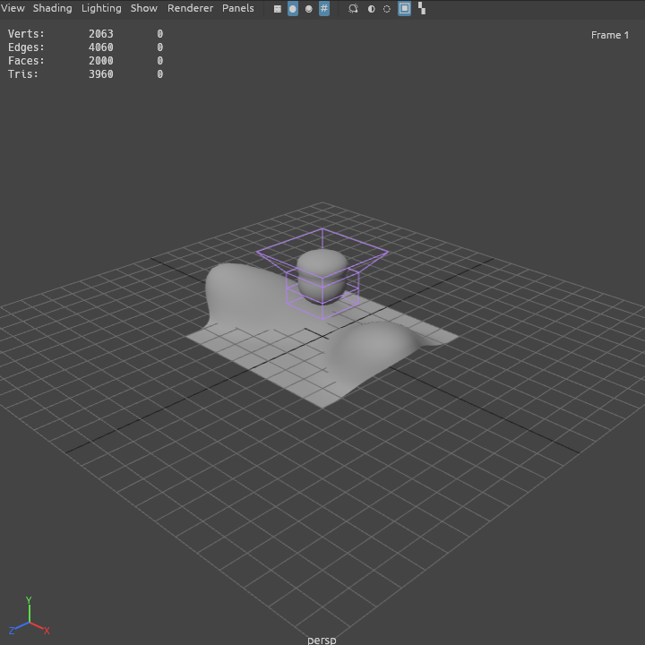

## Curves, surfaces, wire and Quad Draw (v1.7)

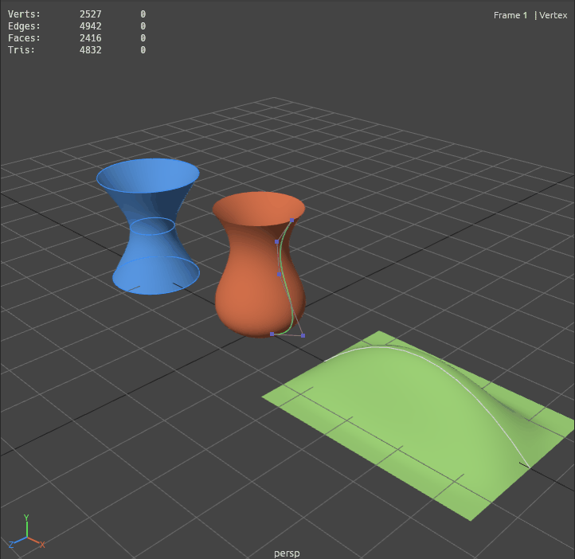

**NURBS curves** are non-rational B-splines: CVs, a degree (1 = linear, 3 = cubic, Maya's default) and a knot vector
(clamped uniform for open curves, periodic for closed ones).

| | |
|---|---|
| **Create** | Create › Curve Tools › **CV Curve Tool** / **EP Curve Tool**: click points, Backspace removes the last, Enter creates the curve, Esc cancels. Points land on the grid, or on the live object (Modify › Make Live); hold X to snap. EP curves pass through every point (global interpolation with chord-length parameters). Create › NURBS Primitives › **Circle** makes an exact-looking periodic cubic circle. MEL: `curve -d 3 -p 0 0 0 -p 1 1 0 …`, `curve -ep …`, `circle -r 1 -s 8 -nr 0 1 0`. |
| **Edit** | Vertex mode (F9) edits CVs with the move/rotate/scale manipulators (soft select works), with the CV hull drawn. From MEL: `select crv.cv[2:4]; move -r 0 1 0`. The same component syntax works on meshes (`pCube1.vtx[0:3]`, `.e[5]`, `.f[*]`), and `pointPosition crv.cv[0]` reads a world position. |
| **Curves menu** | **Rebuild** (uniform spans, degree 1/3; a least-squares fit with parameter correction), **Reverse Direction**, **Open/Close**, **Attach** (joins the nearest ends), **Detach** (exact knot insertion; `detachCurve crv.u[1.5]`). The Attribute Editor shows degree, spans, form, length and what each curve drives. |
| **Surfaces menu** | **Revolve** (axis, sections, sweep), **Loft** (through two or more curves, cubic across sections, optional close), **Extrude** (a profile swept along a path with rotation-minimising frames, or straight by a length), **Planar** (fills a closed curve; ear-clipped when concave). The results are polygon meshes with UVs and **live construction history**: moving a CV, rebuilding or transforming an input curve rebuilds the mesh. The Attribute Editor edits sections, sweep and samples; Delete History freezes the mesh. |
| **Wire deformer** | Deform › **Wire**: select the meshes, then the curve. Vertices within the dropoff distance (automatic, or `-dds 0 1.5`) follow the curve with a smooth falloff; the *rotation* setting turns them with the curve's tangent and *envelope* scales the effect. `wire -w crv -dds 0 1.5 mesh`, `wire -e -w crv -en 0.5`. |
| **Quad Draw** | Mesh Tools › **Quad Draw** (the selected mesh becomes live): **click** to place dots on the live surface · **drag** a dot to move it (it stays on the surface) · **Shift+click** fills a quad from the four nearest dots, with a green preview while Shift is held · **Ctrl+Shift+click** fills a triangle · **Ctrl+drag a border edge** extends a new quad · **Ctrl+click** deletes a dot or face · **Relax** (Tool Settings) evens out interior dots and re-projects them. Enter or right-click finishes, removing unused dots. Faces wind consistently: they follow their neighbours, or point out of the live surface. MEL: `makeLive ref; quadDraw -dot x y z; quadDraw -quad 0 1 2 3; quadDraw -extend 1 2 0.5 0 0; quadDraw -relax 10; quadDraw -finish`. |

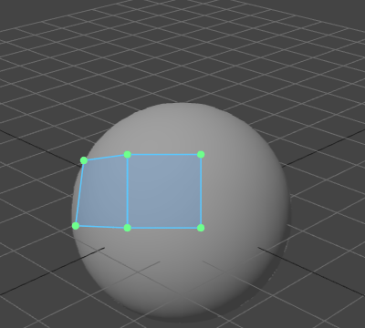

Curves export to USD as `NurbsCurves` (order, knots, ranges; periodic curves in their wrapped form), which pass all of
Pixar's USD validators, and import back with the same shape. Degree-1 curves (rig controls) stay `BasisCurves`. Saved
scenes keep degrees, knots, surface history and wires; scenes from older versions load their curves as degree 1.

## FX: particles and cloth (v1.8)

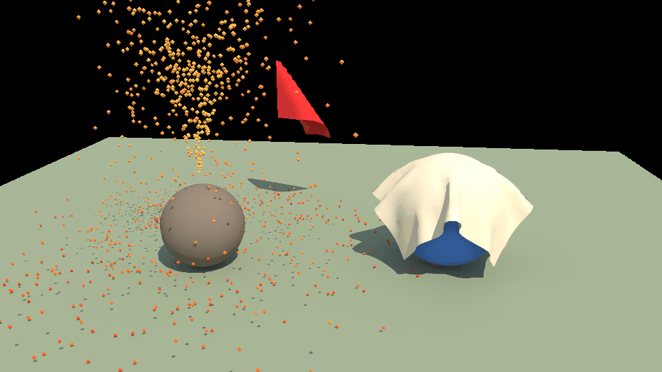

Switch the menu set to **FX** (or use the FX shelf). Simulations run as the time slider moves: each frame is cached, so
scrubbing back is instant and exact. Changing a setting, the animation of an emitter, pin target or collider, or a
collider's mesh re-simulates from the start frame (the playback start when created). Emitters, pins and colliders follow
the fully evaluated rig, including constraints, IK and skinning, so cloth can hang from a Quick Rig character.

| | |
|---|---|
| **nParticles** | **Create Emitter** (omni), **Directional Emitter**, **Volume Emitter** (scale the emitter to size the box), **Emit from Object** (random points on a mesh, along its normals, or along a curve). Settings in the Attribute Editor: rate, speed (± random), spread, lifespan (± random), gravity, drag toward the **wind**, **turbulence** (strength, frequency), ground plane, bounce, friction, radius, start / end colour (by age), seed, substeps. Particles draw as small shaded octahedra, so they also render in the path tracer. |
| **nCloth** | **Create nCloth** turns meshes into cloth (position-based dynamics: stretch, shear and bend constraints with substeps). Settings: stretch and bend resistance, damping, aerodynamic drag with **wind** (pushes along the cloth's normals, so flags and sails catch it), thickness, friction, gravity, ground plane, substeps / iterations. **Pin Selected Vertices** fixes vertices to the cloth's own transform, or to any joint, control or object (Attribute Editor › *Pins follow*). |
| **Collisions** | **Make Collide**: select collider meshes, then the particle system or cloth. Particles test their path against the collider triangles each substep (no tunnelling); cloth keeps its thickness from the surface. Colliders can be animated or skinned. |
| **Export** | USD: particles export as an animated `Points` prim (positions per frame, widths, colour); cloth exports as per-frame mesh points, like other deformers. Scenes save the settings; caches are rebuilt on load and come out identical. |

MEL: `emitter -type omni|dir|surface|curve|volume -r 200 -spd 3 -sp 20 -dir 0 1 0 -lifespan 2 -n fx [sourceMesh]`,
`setAttr fx.turbulence 2`, `getAttr fx.count`, `nCloth -stretch 1 -bend 0.1 cape`, `clothPin -to chest_jnt cape.vtx[0:12]`,
`setAttr cape.wind 4 0 0`, `connectDynamic -c body cape`, `removeNCloth cape`.

Speed on the 2-core test VM: a 41×41 cloth draped on a sphere simulates at about 39 ms/frame, and a 2,000 particles/s
fountain (≈6,000 alive) with turbulence and a collider at about 3 ms/frame.

### Fields, hair, dynamic curves and cloth self-collision (v2.0)

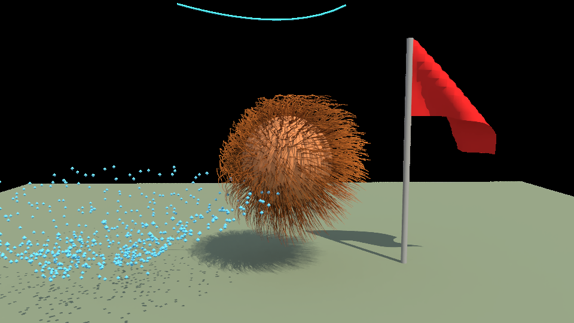

| | |
|---|---|
| **Fields** (FX › Fields/Solvers, or the Air / Turb / Vortex shelf buttons) | **Air** (wind velocity plus how fast things reach it), **Gravity**, **Uniform**, **Radial**, **Vortex**, **Turbulence**, **Drag** and **Newton** (attractor). Fields are scene nodes: move, rotate, key or constrain them to place and aim them. Each has magnitude, direction or axis, attenuation (falloff with distance) and max distance. A field acts on the simulations that were selected when it was created, or on every particle system, cloth and hair if none were. **Affect Selected Object(s)** and `connectDynamic -f` / `-rf` change its targets. Cloth feels air fields through its aerodynamic model, so flags flap instead of sliding. |
| **nHair** | **Create Hair** grows strands from random points of a mesh. Settings: count, length (± random), segments, tilt, curl and comb direction / amount. The roots ride the deforming mesh, so hair follows a skinned head. Strands are simulated with follow-the-leader constraints and the DFTL velocity correction, which keeps them inextensible and rope-like. Further controls: a stiffness ramp from root to tip that pulls toward the styled shape, gravity, drag and wind, fields, and collisions with the growth mesh, other colliders and the ground. Hair draws as tapered tubes with a root-to-tip colour, in the viewport and in the path tracer. **Convert Hair to Curves** bakes the current strands into NURBS curves. |
| **Dynamic curves** | **Make Selected Curves Dynamic** turns a curve into a one-strand hair system pinned at its start, or at both ends with `-pinTip`. The simulation writes into a new `<curve>_dyn` curve, which other tools can use as input, such as wire deformers or extrude and loft surfaces. |
| **Cloth self-collision** | **Self collision** in the nCloth attributes, or `nCloth -selfCollide`, keeps folds from passing through each other. It works by repelling vertices with a spatial hash; neighbours at rest are skipped. The radius defaults to 45 % of the average edge length. |
| **Export** | **glTF:** cloth and other point deformers (clusters, lattices, wraps, wires) bake to one morph target per frame, with one-hot weight animation (up to 300 targets; longer ranges are sampled evenly). Hair becomes a LINES mesh with the same per-frame morph targets. Particles become child nodes, one per particle slot, sharing an octahedron mesh, with animated translation and STEP-animated scale for birth and death. The Khronos glTF validator reports no errors. **USD:** hair writes `BasisCurves` with `points.timeSamples`, tapered widths and colours; pxr's validators report no issues. |

MEL: `airField -m 6 -dx 1 -dy 0 -dz 0 -s 2 -n wind flag fur`, `vortexField -m 4 -p 0 1 0`, `turbulenceField -m 3 -f 1`,
`newtonField -m 5 -att 2`, `field -type radial`, `setAttr wind.maxDistance 5`, `connectDynamic -f wind cape`,
`hairSystem -count 1500 -length 0.45 -seg 8 -curl 30 -stiff 0.15 -rgb 0.55 0.3 0.12 -n fur head`,
`setAttr fur.comb 0 -1 -1; setAttr fur.combAmount 0.6`, `makeCurvesDynamic -pinTip rope`, `hairToCurves fur`,
`nCloth -selfCollide cape`, `setAttr cape.selfThickness 0.02`.

Speed on the 2-core test VM: 1,000 strands × 8 segments on a colliding sphere in a turbulence field simulate at about
27 ms/frame.

## Rendering: path tracer and Render View (v1.1)

Status line **🎬** (or Rendering › Render › Render Current Frame, the *Render* shelf button, or `render`) renders the active view — or any camera — with a built-in multi-threaded **CPU path tracer** into the **Render View** window. The image refines progressively; **IPR** re-renders automatically whenever geometry, materials, lights, the camera or the settings change (selection changes don't).

- **Materials:** Lambert / Blinn / Phong / standardSurface colour, specular, roughness (GGX), metalness, incandescence (emissive), transparency and file textures (including the UV checker).
- **Lights:** directional, point and spot lights (cone + penumbra) with ray-traced shadows, ambient lights, and a sky dome (*Sky*). An empty scene uses a default key light like the viewport.
  - **Area lights** (v1.4): Create › Lights › Area Light, or `areaLight -w 2 -h 1 -p … -aim …`. A rectangle whose size comes from its scale; it gives soft shadows and natural falloff in renders, and the viewport shows an approximation. The *product* light-rig preset uses three area-light softboxes. USD export writes a `RectLight`; glTF has no area lights, so they are skipped there.
- **Global illumination:** diffuse and glossy bounces (default 4) with Russian roulette; a *Clamp* setting fights fireflies.
- **Denoiser** (v1.4, on by default; *Denoise* in the Render View, `renderSettings -dn on|off`): an edge-aware à-trous wavelet filter guided by the first-hit albedo, normals and each pixel's measured variance. It removes most Monte Carlo noise without blurring textures or geometric edges, and keeps mirror reflections sharp. In the tests it cut the error of a 4-samples-per-pixel render by more than 60% in smooth areas, and it takes about 0.35 s on a 640×360 image.
- **Render passes** (v1.5): the Render View's pass menu shows **Beauty, Albedo, Normal, Depth** (brighter = closer) and **Object ID**. *Save passes…* (or `render … -o shot.png -passes`, `renderView -save shot.png -passes`) writes `shot_beauty.png`, `shot_albedo.png`, …
- **Render region** (v1.5): Shift-drag a rectangle on the image to re-render only that area; the rest of the previous render stays. IPR keeps updating just the region; *✖ Region* goes back to the full frame (`renderSettings -region 0.25 0.25 0.75 0.75`, `-region off`).
- **Depth of field** (v1.5): camera Attribute Editor › *Depth of Field*, with **F Stop** and **Focus Distance** (*Focus on selection* measures it) and a **Blur ×** scale, since real lenses are subtle at 1 unit = 1 m. It is a thin-lens model, and `setAttr cam.depthOfField 1; setAttr cam.fStop 2; setAttr cam.focusDistance 7` does the same.
- **Output:** exposure, sRGB or Filmic (ACES) tone mapping, and a sky or transparent background (PNG alpha). Save… writes a PNG, and **Sequence…** renders a frame range to `name.0001.png …` without blocking the UI.

```
render -x 1280 -y 720 -spp 128 -b 4 -cam shot -o C:/renders/still.png     (blocking still)
render -seq -st 1 -e 48 -o C:/renders/walk                                (image sequence)
renderSettings -x 960 -y 540 -spp 64 -env 0.3 -exp 0.5 -tm filmic -bg env   renderView -ipr on | -stop | -save C:/r.png
```

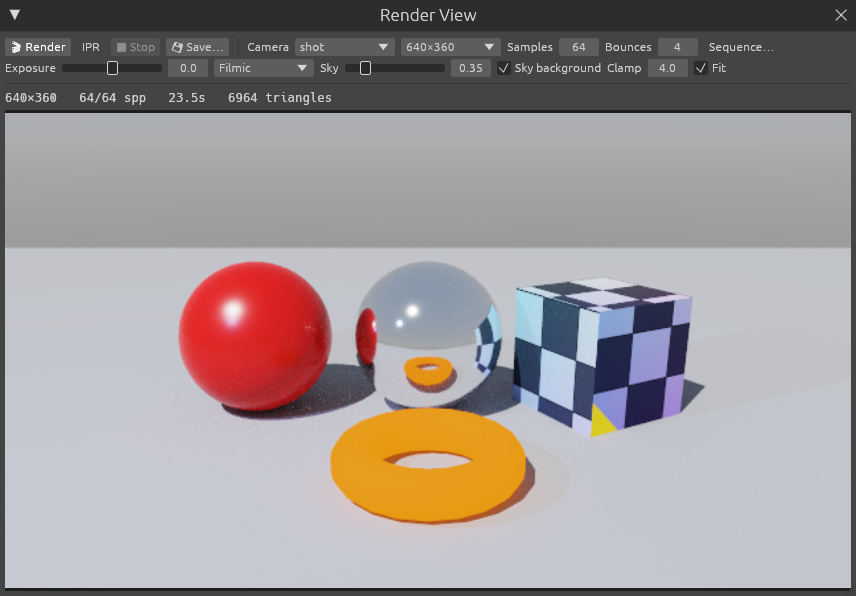

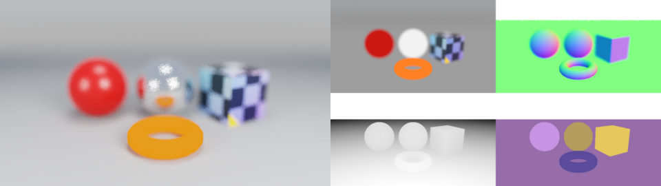

### Motion blur, light-path passes and batch rendering (v2.2)

- **Motion blur:** tick *Motion blur* in the Render View (or `renderSettings -mb on -shutter 0.5`). The shutter is open for *Shutter* frames, centred on the current frame (0.5 = a 180° film shutter). The renderer samples the scene at shutter open and close and moves every triangle between the two per sample. Moving and rotating objects, deforming skinned characters, blend shapes and camera moves all blur. Simulations (particles, cloth, hair) are cached per whole frame, so they blur only with a shutter of 1 frame or more. A scene with nothing moving renders exactly as it does with motion blur off.
- **Light-path passes:** the pass menu adds **Diffuse Direct, Diffuse Indirect, Specular** and **Emission**. Emission includes self-lit surfaces and sky seen directly. The four add up to the beauty before denoising. Each is estimated on its own: the first bounce picks either the diffuse or the specular lobe and weights it by that lobe alone. They are not denoised, so for compositing render with more samples.
- **EXR:** a save path ending in `.exr` writes linear 32-bit float images (beauty with exposure applied and no tone mapping). The passes are written raw: normals as −1..1, depth as camera distance, object IDs as numbers.
- **Batch renderer:** `rust_maya --render scene.rma` renders without opening a window, so it works on a headless server or VPS with no GPU or display. It uses the Render Settings and render camera saved in the scene, which are now stored in the .rma file. Without a saved camera it uses the first camera node. Command-line flags override any setting. Progress and an ETA print per frame. Exit codes: 0 = done, 1 = file or render error, 2 = bad arguments. On Windows the app is a windowed program, so the terminal doesn't wait for it. In PowerShell, add `| Out-Host` to wait and see the progress (`.\rust_maya.exe --render shot.rma -all | Out-Host`), and `$LASTEXITCODE` holds the exit code. In cmd, use `start /wait rust_maya.exe --render …`. `rust_maya --version` prints the version. Run `rust_maya --help` for every option.

```
rust_maya --render shot.rma -s 1 -e 120 -o renders/shot.png                 (frames → shot.0001.png …)
rust_maya --render shot.rma -f 48 -x 1920 -y 1080 -spp 256 -mb on -passes -o out/f48.exr
rust_maya --render shot.rma -all -cam closeUp -shutter 0.5 -q               (playback range, quiet)
rust_maya --render shot.rma -mel "hide hero" -o no_hero.png                (MEL before rendering)
render -o C:/r/shot.exr -passes specular,emission                           (MEL: just some passes)
```

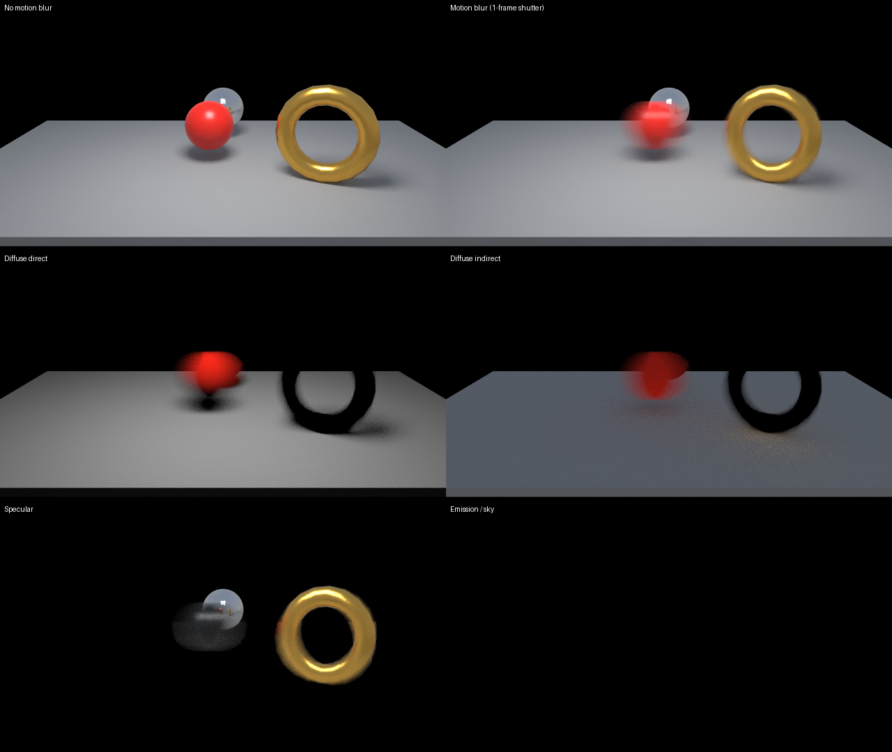

## Performance (v0.6)

The viewport keeps a fingerprint of everything that affects drawing. If nothing changed, the last frame's geometry is
reused and nothing is uploaded to the GPU. Each mesh's GPU vertices are cached per node and rebuilt only when that node changes
(transform, mesh edit, material, selection, deformer inputs), and the renderer re-uploads only the blocks that changed.
Deformed meshes reuse their cached triangulation and recompute normals across threads. On the 2-core test machine a frame
with a 20k-vertex skinned mesh deforming went from about 33 ms to about 9 ms, and a frame where nothing changed costs about 0 ms.

## AI: Ollama, OpenRouter, Whisper voice and the tev1 decision model

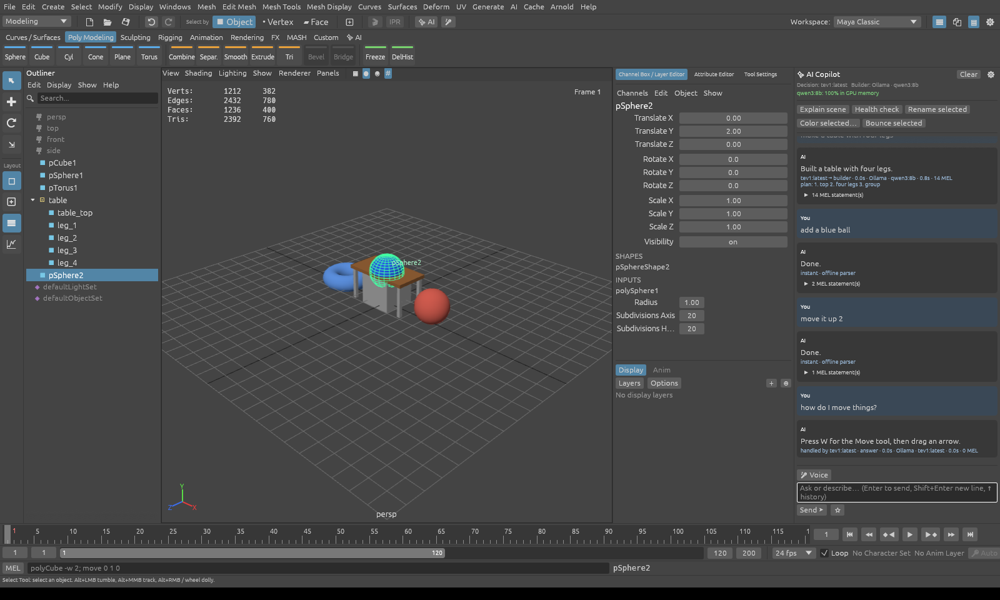

The AI changes the scene only through **MEL**, using the same interpreter as the command line. Every AI action is
therefore validated, logged in the Script Editor and undoable. A whole AI request is **one undo step**.

### Setup

* **Ollama (local):** install from https://ollama.com and run `ollama pull qwen3:8b` (the builder). Also pull or create
  your **`tev1`** decision model; any installed model named `tev1…` is picked up automatically.
* **OpenRouter (cloud, optional):** set the `OPENROUTER_API_KEY` environment variable, or paste the key in
  **AI → AI Settings**. The live model catalogue appears in the model pickers, with filters for tool-calling and free models.
* **Voice:** the first time you press the mic button (or the **`** key), the chosen Whisper model is downloaded once from
  Hugging Face (`base.en` is about 145 MB) and cached in your user cache folder under `rust_maya/whisper/`. It then runs
  fully locally through `candle`. To build without voice, use `cargo run --release --no-default-features`.

Settings are saved to `%APPDATA%\rust_maya\ai_settings.json` on Windows (`~/.config/rust_maya/` on Linux). If you type
the OpenRouter key into AI Settings, it is stored there in plain text; the environment variable keeps it out of the file.

### How a request flows

1. The **instant parser** handles simple phrases ("undo", "top view", "add a red sphere", "move it up 2") with no model.
2. The **tev1 decision model** reads the request plus a scene summary and calls one of three tools: `run_mel` (does
   simple edits itself), `answer` (questions) or `delegate_to_builder` (creative or multi-object builds, with a plan).
   It uses native tool calling when the model supports it and JSON routing otherwise. The chat shows who handled each
   request, for example "tev1 → builder · plan: …".
3. The **builder model** (Ollama or OpenRouter) streams `{"reply", "mel": [...]}`. Each statement runs as soon as it
   arrives. If the builder fails, the **fallback** model is tried.

### The 20 AI enhancements

| # | Enhancement | Where |
|---|---|---|
| 1 | **AI Copilot panel**: streaming chat, MEL runs while the model types, Stop button, one undo step per request | ✨ AI button, Ctrl+L |
| 2 | **Ollama provider**: auto-picks the best installed model, in-app `ollama pull` with progress, GPU-memory readout | AI Settings |
| 3 | **OpenRouter provider**: live catalogue, filters (tool-calling / free), API key or env var, SSE streaming | AI Settings |
| 4 | **tev1 decision router**: direct / answer / delegate routing via tool calls, with JSON fallback | automatic |
| 5 | **Per-role models**: Decision, Builder, Helper and Fallback, mixing local and cloud models freely | AI Settings |
| 6 | **Automatic fallback**: for example, Ollama is offline so the request goes to OpenRouter | AI Settings → Fallback |
| 7 | **Whisper voice commands**: tiny, base, small or distil-small, run locally, with a mic level meter | 🎤, ` key |
| 8 | **Hands-free listening**: stops when you pause (adjustable threshold), auto-send or review first | AI Settings |
| 9 | **Spoken replies** through the system's text-to-speech (Windows SAPI, macOS `say`, Linux `spd-say`/`espeak`) | AI Settings |
| 10 | **Instant offline parser** for common commands, with zero latency and no model needed | automatic |
| 11 | **AI mode for the command line**: the MEL button toggles MEL ↔ AI, like Maya's MEL/Python switch | command line |
| 12 | **Find Menu**: fuzzy search over commands; anything not found can be sent to the AI as a question or a request | F3 / Ctrl+K |
| 13 | **Generate MEL** from a description, placed in the Script Editor for review | Script Editor |
| 14 | **Explain MEL**: plain-language walkthrough of the current script | Script Editor |
| 15 | **Fix with AI**: repairs the last failing MEL using its error message | Script Editor, AI menu |
| 16 | **Smart Rename**: descriptive names from each object's shape, size, position and hierarchy | Outliner right-click, AI menu |
| 17 | **AI color palette** for the selection from a mood ("warm sunset", "neon cyberpunk"…) | AI menu, Copilot |
| 18 | **Scene Health Check**: rule-based report (unfrozen transforms, history, n-gons, default names…), plus AI advice and one-click fixes | AI menu, AI shelf |
| 19 | **AI animation**: keyframes from plain language ("bounce three times over 72 frames"), using `setKeyframe -t -at -v` | Copilot |
| 20 | **AI shelf, saved prompts and history**: ⭐ saves a prompt as a shelf button; ↑/↓ recalls earlier prompts (both persist) | ✨ AI shelf tab |

New MEL commands added for the AI (and for you): `setColor`, `selectFaces x y z`, `polyExtrudeFacet -ltz`, `viewSet`,
`viewFit`, `panelLayout`, `displayMode`, `hide`, `showHidden`, `cutKey`, and `setKeyframe -t/-at/-v`.

### AI recipes and render check (v1.2)

The Copilot has four recipe buttons. The recipes also work offline, by typing or speaking short requests such as "studio lighting", "make it chrome", "make him walk" or "render check". Builder models are prompted to use them as high-level building blocks.

| Recipe | What it does | MEL |
|---|---|---|
| **💡 Light** | Light rigs fitted to the subject's bounds: **studio** (three-point), **outdoor**, **sunset**, **night**, **product**, **dramatic**. The lights are named (key_light, rim_light, …) and grouped as `lightRig`, so re-running replaces the rig and the AI can fine-tune it with `setAttr`. The sky level for the path tracer is set too. "Let the AI light it…" sends the job to the builder model. | `lightRig -preset sunset [-i 1.2] [-target obj]` |
| **🎨 Materials** | 19 tuned presets (gold, chrome, glass, car paint, wood, marble, skin, neon…), applied to the selection and shared as `<preset>_mat`; `-rgb` tints a preset. "Let the AI shade the scene…" asks the model to give every object a fitting material. | `materialPreset -p car_paint -rgb 0.1 0.2 0.8 body` |
| **🏃 Rig & animate** | Quick Rigs the selected mesh if there is no rig yet, then keys a procedural **walk, run, jump, wave, idle or dance** on the controls. During a walk the planted foot stays put, and it all goes in one undo step. | `rigAnimate -anim walk -s 1 -e 96 [-travel off] body` |
| **🔍 Render check** | Renders a 384×216 preview with the path tracer and measures it: coverage, exposure, contrast, clipped highlights and crushed blacks, objects cut off at the frame edge, missing lights, unshaded meshes. It shows the image with the findings and one-click fixes. The preview is then sent to a **vision model** (an installed `gemma3`, `qwen2.5vl` or `llava`, or OpenRouter `gpt-4o-mini`; set it under AI Settings › Vision), which writes a critique and suggests fixes. A text-only model gets the measurements instead. | `renderCheck [-x 320 -y 180 -spp 16]` |

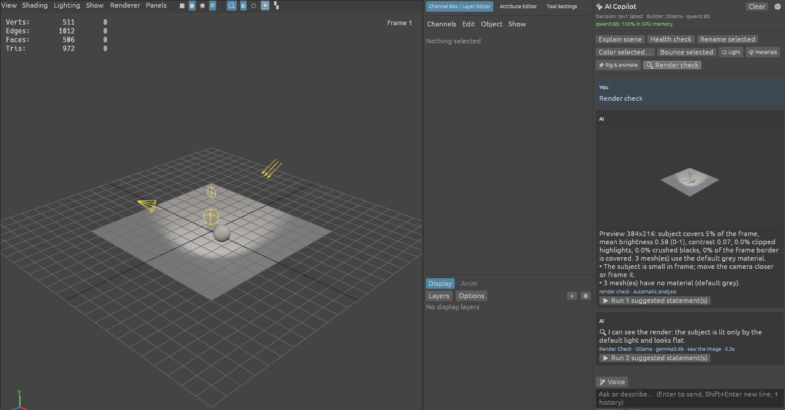

### Director, rig explainer and posing (v1.9)

Three AI features that also work fully offline:

- **🎬 Make a shot.** Describe a shot, e.g. "make a shot of a robot waving in a forest at sunset with fireflies, orbit camera". A keyword parser turns the description into one `makeShot` statement. When a model is connected, it gets that draft and refines it (theme, subject, action, mood, camera move, FX), then the shot is built in **one undo step**:
  - a themed set (forest, city, desert, beach, studio, snow, space);
  - a human, robot or alien character, Quick Rigged and animated;
  - FX presets (rain, snow, sparks, fireflies, dust, leaves, cape, flag);
  - a light rig matching the mood and path-tracer settings;
  - an animated `shotCam` (static, track, dolly, orbit or crane) that the viewport looks through.

  A render check then runs on the result. The building blocks are also commands of their own: `character`, `environment`, `shotCamera` and `fxPreset`.
- **🦴 Explain rig.** `rigReport` describes the skeleton chains, IK handles (poles, drivers), controls and constraints, driven keys, skins, deformers, cloth and particles. It flags problems and lists a fix for each, offered as a button:
  - unnormalised or missing weights (`skinPercent -normalize`);
  - more than 4 influences, or unused influences;
  - unoriented or scaled joints;
  - IK chains with no pole vector;
  - nodes that are keyed and also constrained;
  - drivers that were deleted;
  - left/right names without a mirror partner.

  With a model connected, the report is also explained in plain language.
- **Voice and typed posing.** Phrases like "raise both arms a lot, bend the right elbow 60 degrees and turn the head left", "look up", "crouch 10 cm", "step forward with the left foot and key it" or "lean back a bit" become `pose` commands with no model involved, so they work with Whisper voice too.
  - On a Quick Rig, `pose` swings the hand and foot IK controls around the shoulder and hip, which keeps limb length. Elbow and knee bends use the law of cosines, and the head, chest and cog controls are rotated or moved.
  - On FK skeletons it rotates the joints themselves, found by fuzzy names (`LeftArm`, `arm_l`, `L_shoulder`).
  - On an animated rig the pose is keyed at the current frame so it sticks.

```
makeShot -theme beach -subject human -anim idle -mood sunset -camera static -fx cape -wind -s 1 -e 72
pose -part arm -side both -action raise -amount large
pose -part elbow -side R -action bend -amount 60
pose -part head -action turn -dir left
rigReport
```

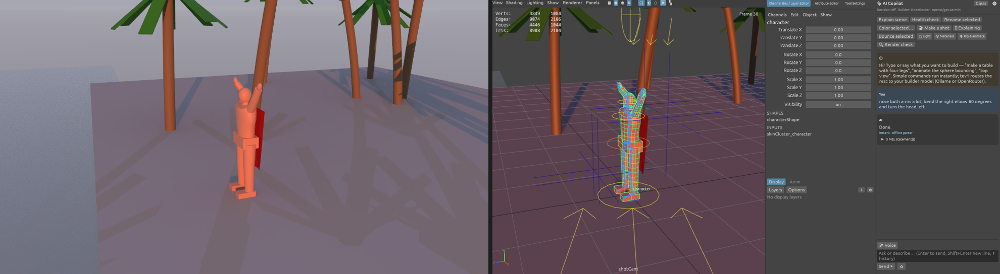

### Testing without models

`tools/mock_ai.py` imitates both the Ollama and OpenRouter APIs, including tev1 tool calls and streaming:

```
python tools/mock_ai.py 8765
set MOCK_AI=http://127.0.0.1:8765 && cargo test mock -- --ignored
```

To try the UI against it, set the Ollama host to `http://127.0.0.1:8765`, the OpenRouter key to `sk-or-test`, and
`"openrouter_url": "http://127.0.0.1:8765/api/v1"` in `ai_settings.json`.

## Hardware and VPS

See [docs/VPS_SPECS.md](docs/VPS_SPECS.md) for the specs needed to run Rust Maya and Ollama models on a VPS (or to host only Ollama there).

## Project layout

```
src/
  main.rs        app entry (eframe + wgpu); --render / --help / --version
  batch.rs       command-line batch renderer (no window)
  scene.rs       DAG nodes, channels, keyframe curves, layers, materials
  mesh.rs        n-gon mesh, primitives, extrude, Catmull-Clark, shells, OBJ I/O, deformed-normal fast path
  mesh_ops.rs    edge loops/rings, insert edge loop, bevel, bridge, merge, mirror, dissolve edge
  nurbs.rs       B-spline curves (evaluate, interpolate, rebuild, detach/attach) and revolve/loft/extrude/planar with history
  curve_ops.rs   undoable curve, surface and wire actions + their MEL commands
  quad_draw.rs   Quad Draw retopology (live surface snapping, fill, extend, relax)
  deform.rs      lattice, wrap and wire deformers
  fx.rs          particles, cloth (with self-collision) and fields: emitters, forces, collisions, PBD cloth,
                 per-frame caches, FX MEL
  hair.rs        hair systems and dynamic curves (DFTL strands, rest-shape stiffness, collisions)
  director.rs    "make a shot": characters, themed sets, shot cameras, FX presets, text → makeShot
  rig_report.rs  rig explainer (rigReport) and skin weight normalising
  posing.rs      pose command and the plain-English pose parser
  modeling_ops.rs undoable edge-modeling actions
  prefs.rs       preferences, recent files, autosave and crash recovery
  look.rs        materials, lights, cameras, look-through, GPU light setup
  export/        glTF 2.0 (.glb/.gltf) and USD (.usda) exporters with animation baking
  importer/      glTF 2.0 and USD (.usd/.usda/.usdc/.usdz: parser, composition, MaterialX, UsdSkel) importers
  fbx/           FBX node tree (binary reader/writer, ASCII reader), FBX importer and exporter
  reduce.rs      Mesh › Reduce (quadric decimation) and Soften / Harden Edge
  camera.rs      persp/ortho cameras, projection, picking rays
  render.rs      wgpu renderer (offscreen MSAA + depth, shaded/line pipelines, blit into egui)
  app.rs         editor state and every undoable action
  commands.rs    MEL-like command interpreter
  rig.rs         skinning, blend shapes, clusters, IK (twist/stretch), constraints, driven keys, joint orient
  rig_ops.rs     undoable rigging actions (incl. mirror joints/weights, Quick Rig) for menus, tools, MEL and the AI
  ai/            providers (Ollama + OpenRouter), tev1 router, prompts, stream/offline parsers, scene context
  voice.rs       cpal microphone + VAD + Whisper on candle (feature "voice", on by default)
  tts.rs         spoken replies via the OS text-to-speech
  ui/            menus+status line+shelf, panels (toolbox/outliner/channel box/AE), timeline,
                 viewport (navigation, picking, manipulators, joint tool, weight painting, HUD), floating
                 windows, copilot (AI UI), rigging (menus, tool settings, Set Driven Key),
                 lookdev (Hypershade, light/camera/material editors, Rendering shelf)
```

## Roadmap

These items appear in the UI as disabled "planned" entries:
- Modeling: NURBS surfaces as true NURBS (today surface tools output polygons)
- USD value clips, FBX NURBS curves, sub-frame simulation motion blur
- FX: fluids, hair clumping / shading models, cloth tearing

*Not affiliated with Autodesk. Maya is a trademark of Autodesk, Inc.*
